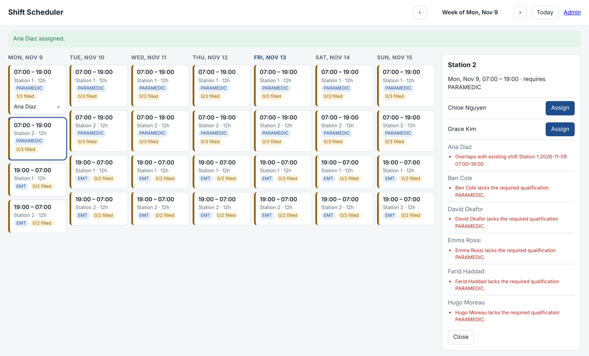

# Shift Scheduler

A rules-driven shift scheduling application for emergency services (Fire, EMS, Police), built with Django, Django REST Framework, PostgreSQL, and Vue 3.

Emergency-services scheduling is hard because every assignment must respect qualifications, rest periods, and contractual hour caps. This project models those constraints explicitly and explains every rejected assignment, before the scheduler even clicks.



> Status: work in progress. Done: data model, rules engine, REST API, Vue scheduling board, tests. Next: continuous integration.

## What it enforces

| Rule | Example rejection |
|---|---|
| Required qualification | `Ana Diaz lacks the required qualification PARAMEDIC.` |
| No overlapping shifts | `Overlaps with existing shift Station 1 2026-11-02 07:00–19:00.` |
| Minimum rest between shifts (configurable, default 10h) | `Only 9h of rest next to shift ... (minimum 10h).` |
| Weekly hour cap per employee | `52h in the week of 2026-11-02 exceeds the 48h cap.` |
| Shift capacity (crew size) | `All 4 slot(s) on this shift are filled.` |
| Active employees only | `Ana Diaz is not active.` |

All violations are reported at once, so a scheduler can fix everything in one pass.

## Design decisions

- **Rules are plain functions** (`scheduling/rules.py`). Each receives the employee, the candidate shift, and the employee's other shifts, and returns violations. Adding a rule means writing one function and registering it.
- **One entry point for assignments** (`scheduling/services.py`). The admin, the API, and the Vue board all go through `assign_employee`, so the rules cannot be bypassed.
- **Concurrency safety.** Assignment creation runs in a transaction with row locks (`select_for_update`), so two schedulers cannot double-book a person or over-fill a shift at the same moment.
- **Hours are counted where they are worked.** An overnight shift from Sunday 19:00 to Monday 07:00 counts 5h in one week and 7h in the next, using the agency's local time zone.
- **The database guards what it can.** Check constraints reject shifts that end before they start; a unique constraint prevents duplicate assignments.
- **Explain before acting.** The board asks the API which employees are eligible for a shift and shows the reasons for the others, instead of letting the scheduler try and fail.
- **Time zones are explicit.** Datetimes are stored in UTC; weeks, messages, and the board use the agency's time zone (`APP_TIME_ZONE`), whatever the browser's zone.

## REST API

All endpoints require a logged-in user (session authentication with CSRF protection).

| Method | Endpoint | Purpose |
|---|---|---|
| GET | `/api/shifts/?week=2026-11-11` | Shifts overlapping that week (Monday to Sunday), including overnight shifts from the previous Sunday |
| GET | `/api/shifts/{id}/eligible/` | Active employees for a shift: allowed ones first, then the others with their violations |
| POST | `/api/assignments/` | Assign `{"employee": 1, "shift": 5}`. Returns **201**, or **422** with the full list of violations |
| POST | `/api/assignments/check/` | Dry run: same input, returns `allowed` and `violations`, saves nothing |
| DELETE | `/api/assignments/{id}/` | Remove an assignment |
| CRUD | `/api/employees/`, `/api/shifts/` | Manage employees and shifts |
| GET | `/api/stations/`, `/api/qualifications/` | Reference data |

Example of a rejected assignment:

```json
HTTP 422
{
  "violations": [
    {"code": "missing_qualification", "message": "Ben Cole lacks the required qualification PARAMEDIC."},
    {"code": "overlap", "message": "Overlaps with existing shift Station 1 2026-11-09 07:00–19:00."}
  ]
}
```

## Scheduling board (Vue 3)

The board at `/` shows a week of shifts per day, color-coded by staffing (open or full). Selecting a shift opens a panel listing eligible employees with an **Assign** button, and blocked employees with the reasons. Vue is loaded from a CDN with no build step, which keeps the project easy to run; the board talks to the backend only through the REST API.

## Run locally (macOS)

```bash
python3 -m venv .venv
source .venv/bin/activate
pip install -r requirements.txt

createdb shift_scheduler           # PostgreSQL must be running
python manage.py migrate
python manage.py seed_demo         # demo stations, employees, and two weeks of shifts
python manage.py createsuperuser
python manage.py runserver
```

Open http://127.0.0.1:8000/, sign in, and start assigning. The Django admin is at `/admin/`. Run `python manage.py seed_demo --reset` to start over with fresh demo data.

Database settings come from environment variables (`DB_NAME`, `DB_USER`, `DB_PASSWORD`, `DB_HOST`, `DB_PORT`). Set `DB_ENGINE=sqlite` to run without PostgreSQL.

## Tests

```bash
pytest
```

26 tests cover each rule and its edge cases (rest exactly at the minimum, weekly cap exactly reached, overnight shifts split across weeks, multiple violations reported together) and the API contract (authentication, 201/422 responses, dry run, eligibility ordering, week filtering).

## Tech stack

Python 3.12+, Django 5.1, Django REST Framework, PostgreSQL, Vue 3, pytest.
